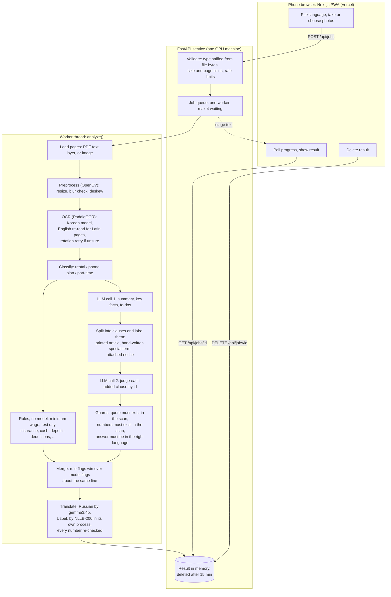

# ClearKo architecture

How a photo of a Korean document becomes an explanation in Uzbek, Russian or English, and where
each safety check sits. The diagram is Mermaid, so GitHub renders it.

## The pipeline

## What each part is for

| Part | Where | Why it exists |
|---|---|---|
| Content-sniffed upload checks | `backend/app/api/main.py` | The file extension and `Content-Type` are chosen by the client; the first bytes are not. |
| Job queue (one worker) | `backend/app/api/jobs.py` | OCR and the LLM share one GPU, and an analysis takes 20-100 s, too long for a single phone request. |
| Rate limiter | `backend/app/api/limits.py` | Per client (hour and day) and a global daily cap, to protect LLM cost. |
| Blur check | `backend/app/preprocess/` | A blurry photo gives wrong digits; better to ask for a new photo than to explain garbage. |
| Script-routed OCR | `backend/app/ocr/routing.py` | The Korean model garbles Latin text and digits (`61,000` read as `6l,ooo`); pages that are mostly Latin are re-read with the English model. |
| Clause labels | `backend/app/explain/clauses.py` | The small model explained a printed standard article backwards, so printed articles and attached notices are not reviewed; only clauses added to *this* contract are. |
| Clause-by-clause review | `backend/app/explain/judge.py` | A single "find the risks" prompt skips clauses; judging every added clause by id cannot. |
| Rules | `backend/app/explain/rules.py` | Some facts are not a matter of model opinion: 9,000 KRW is below the 2026 minimum wage of 10,320 KRW. Rules are deterministic and tested. |
| Quote and number guards | `backend/app/explain/` | Every flag shows the scan's own Korean text, and a number that is not in the scan is marked as unverified. |
| NLLB worker process | `backend/app/explain/nllb_worker.py` | `torch` and PaddleOCR cannot share a Windows process (different cuDNN DLLs), so Uzbek translation runs in a separate process and frees the GPU afterwards. |
| In-memory results | `backend/app/api/jobs.py` | Nothing about a document is written to disk, a database or a log. |

## Where the trust boundaries are

- **Browser to API:** CORS allows only the configured origin; the production frontend sends a
  Content-Security-Policy that lets the page talk only to itself and the API.
- **Behind a proxy:** with `TRUST_PROXY=true` the rate limiter trusts the *last* `X-Forwarded-For`
  entry (added by the one trusted proxy), never the first (client-controlled).
- **LLM provider:** with the default Ollama provider the text never leaves the machine. With
  `LLM_PROVIDER=gemini` it goes to Google, and the privacy page says so (it asks `/api/health`).

## Swappable parts

- **OCR** sits behind `OCREngine` (`backend/app/ocr/base.py`): `recognize(image) -> OCRResult`.
  Only PaddleOCR is implemented. EasyOCR was not added, because it needs `torch`, which conflicts
  with Paddle (see above).
- **LLM** sits behind `LLMClient` (`backend/app/explain/llm_client.py`): Ollama (default) and Gemini.
- **Translators** sit behind `StringTranslator` (`backend/app/explain/translate.py`).
